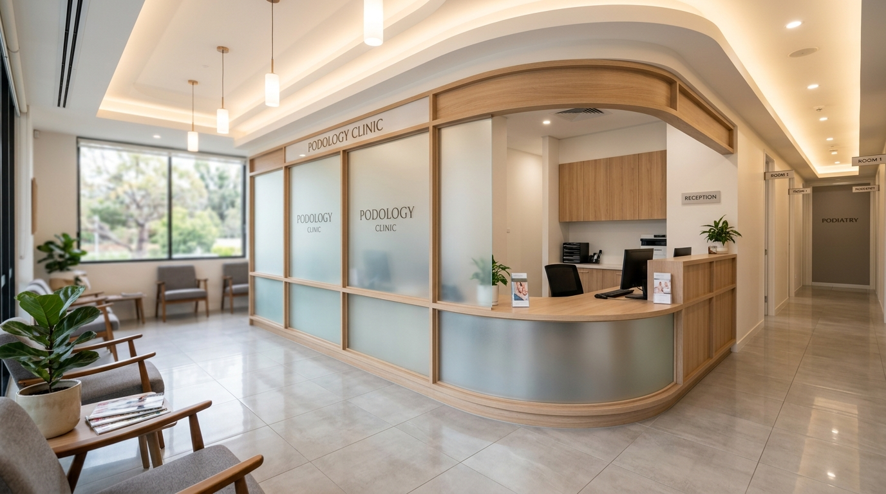
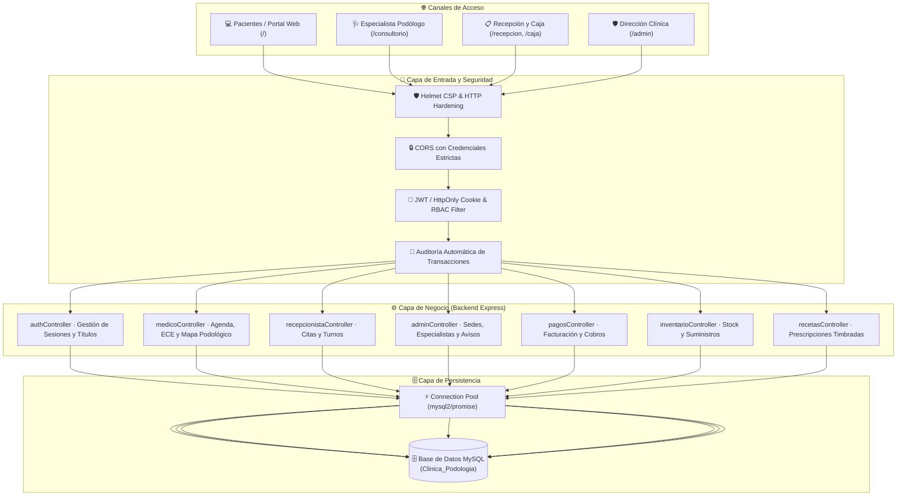

# Elite Foot Care · Plataforma Médica Integral de Gestión Podológica

<div align="center">



**Ecosistema de Software Clínico de Alta Especialidad, Consultorio Médico Inteligente, Recepción Multi-Sede y Portal de Pacientes**

[](https://nodejs.org/)
[](https://expressjs.com/)
[](https://www.mysql.com/)
[](https://github.com/)
[](https://owasp.org/)
[](LICENSE)

**Dominio de Producción:** [`https://elitefootcare.app`](https://elitefootcare.app) · **Entorno Local:** `http://localhost:4000`

</div>

---

## 📋 Resumen Ejecutivo para el Cliente

**Elite Foot Care** es una solución tecnológica integral de grado médico y administrativo concebida para digitalizar, optimizar y blindar cada faceta de la operación podológica.

El sistema articula en una sola plataforma:
1. **La Captación y Experiencia del Paciente:** Portal web boutique de lujo con reservación de citas en línea sin fricciones.
2. **La Eficiencia en Consultorio:** Estación médica especializada para el podólogo con agenda personal por cédula profesional, Expediente Clínico Electrónico (ECE), mapa podológico interactivo de afecciones e impresión de recetas timbradas.
3. **El Control Operativo y Financiero:** Módulos de recepción inteligente, caja registradora con múltiples métodos de pago y gestión de almacén/farmacia.
4. **La Dirección y Seguridad:** Tablero ejecutivo para administradores con métricas en tiempo real, gestión multi-sede y pistas de auditoría bajo el modelo de control de acceso por roles (RBAC).

---

## 📑 Tabla de Contenidos

- [1. Arquitectura del Ecosistema](#1-arquitectura-del-ecosistema)
- [2. Módulos y Portales del Sistema](#2-módulos-y-portales-del-sistema)
  - [2.1. Portal Web Público (Landing de Pacientes)](#21-portal-web-público-landing-de-pacientes)
  - [2.2. Consultorio Podológico (Médico Especialista)](#22-consultorio-podológico-médico-especialista)
  - [2.3. Recepción Clínica y Control de Turnos](#23-recepción-clínica-y-control-de-turnos)
  - [2.4. Módulo de Pagos y Caja](#24-módulo-de-pagos-y-caja)
  - [2.5. Farmacia e Inventario](#25-farmacia-e-inventario)
  - [2.6. Consola de Dirección y Administración](#26-consola-de-dirección-y-administración)
- [3. Identidad Visual y Favicons Adaptativos](#3-identidad-visual-y-favicons-adaptativos)
- [4. Seguridad, RBAC y Cumplimiento Normativo](#4-seguridad-rbac-y-cumplimiento-normativo)
- [5. Estructura del Proyecto](#5-estructura-del-proyecto)
- [6. Modelo de Datos (MySQL)](#6-modelo-de-datos-mysql)
- [7. Catálogo de APIs REST](#7-catálogo-de-apis-rest)
- [8. Guía de Instalación y Despliegue](#8-guía-de-instalación-y-despliegue)
- [9. Credenciales y Perfiles de Prueba](#9-credenciales-y-perfiles-de-prueba)
- [10. Aseguramiento de Calidad y Pruebas](#10-aseguramiento-de-calidad-y-pruebas)

---

## 1. Arquitectura del Ecosistema

El proyecto está diseñado bajo un patrón arquitectónico desacoplado y modular. El servidor central de Node.js/Express actúa simultáneamente como motor de API REST segura y servidor de distribución unificada de activos:



---

## 2. Módulos y Portales del Sistema

### 2.1. Portal Web Público (Landing de Pacientes)
* **Ruta de Acceso:** `http://localhost:4000/` o `https://elitefootcare.app/`
* **Público Objetivo:** Pacientes potenciales y público en general.
* **Capacidades:**
  * **Diseño Editorial Boutique:** Tipografía refinada (*Outfit* & *Plus Jakarta Sans*), componentes visuales fluidos y fotografía clínica de alta gama.
  * **Historias y Anuncios Dinámicos:** Carrusel interactivo alimentado directamente desde la consola administrativa para publicar avisos, promociones o notas médicas.
  * **Catálogo de Servicios de Élite:** Quiropodía especializada, evaluación de pie diabético con prevención de úlceras, biomecánica computarizada y cirugía ungueal reconstructiva.
  * **Agendamiento Exprés en Línea:** Asistente paso a paso para que cualquier paciente agende su cita eligiendo sede, motivo y horario sin requerir registro previo complejo.
  * **Acceso Directo al Personal:** Botón discreto en el encabezado para redirigir al personal autorizado hacia el portal de acceso seguro.

---

### 2.2. Consultorio Podológico (Médico Especialista)
* **Ruta de Acceso:** `http://localhost:4000/consultorio`
* **Rol Autorizado:** `Especialista_Podologo` (Rol ID: `400` / `4`)
* **Capacidades:**
  * **Resolución Dinámica de Identidad:** Saludo personalizado de bienvenida adaptado al especialista que inicia sesión (ej. `¡Hola, Dra. Kiara! 👋` vs `¡Hola, Dr. Luis Angel! 👋`), con iniciales reales en avatar y cédula profesional verificada.
  * **Agenda Personal Estricta:** Aislamiento de consultas médicas según la cédula profesional del especialista activo (`fk_cedula_podologo`), previniendo cruce indebido de información entre podólogos.
  * **Expediente Clínico Electrónico (ECE):**
    * Datos demográficos del paciente (folio de expediente, edad, contacto, calle y municipio).
    * Alertas patológicas críticas destacadas visualmente (**Diabetes Mellitus**, **Hipertensión Arterial**, **Alergias**).
    * Biometría podológica completa: tipo de pisada (Neutra, Pronadora, Supinadora), alineación ósea, peso, talla e Índice de Masa Corporal (IMC) autocalculado.
  * **Mapa Podológico Interactivo:** Registro esquemático y visual de afecciones (hiperqueratosis, helomas, onicomicosis, puntos de sobrepresión) diferenciado de forma anatómica para pie izquierdo y pie derecho.
  * **Prescripción Médica Timbrada:** Generación de recetas digitales foliadas con posología detallada, fecha, diagnóstico e impresión profesional lista para el paciente.
  * **Navegación Unificada:** Pestañas directas y selector rápido de pacientes citados para alternar entre expedientes sin perder el contexto. Botón directo de retorno al **Portal de la Clínica**.

---

### 2.3. Recepción Clínica y Control de Turnos
* **Ruta de Acceso:** `http://localhost:4000/recepcion`
* **Rol Autorizado:** `Recepcionista_Sede` (Rol ID: `300` / `3`)
* **Capacidades:**
  * **Monitor de Sala en Tiempo Real:** Gestión de pacientes en estado *Programada*, *En Sala / Espera*, *En Consulta* y *Concluida*.
  * **Agendamiento y Registro Inmediato:** Creación de nuevos pacientes y vinculación de citas en un solo paso, con validación de folios para evitar duplicados.
  * **Asignación Inteligente de Especialistas:** Distribución de turnos entre los podólogos activos de la sede seleccionada.
  * **Filtros Operativos:** Búsqueda rápida por nombre, teléfono o número de expediente.

---

### 2.4. Módulo de Pagos y Caja
* **Ruta de Acceso:** `http://localhost:4000/caja`
* **Capacidades:**
  * **Cobro de Consultas y Procedimientos:** Desglose del costo del servicio médico e insumos aplicados.
  * **Múltiples Métodos de Pago:** Soporte para efectivo, tarjeta de crédito/débito y transferencias electrónicas.
  * **Corte de Turno:** Registro cronológico de ingresos por día, facilitando el balance de caja al cierre de operaciones.

---

### 2.5. Farmacia e Inventario
* **Ruta de Acceso:** `http://localhost:4000/inventario`
* **Capacidades:**
  * **Control de Existencias:** Monitoreo de stock de medicamentos tópicos, apósitos, hojas de bisturí e instrumental esterilizado.
  * **Alertas de Reabastecimiento:** Notificación visual preventiva cuando un insumo alcanza el umbral mínimo de stock.
  * **Trazabilidad:** Asociación de materiales utilizados en cada procedimiento clínico.

---

### 2.6. Consola de Dirección y Administración
* **Ruta de Acceso:** `http://localhost:4000/admin`
* **Rol Autorizado:** `Admin_Global` (Rol ID: `100` / `1`)
* **Capacidades:**
  * **Gestión de Especialistas:** Alta, baja y actualización de podólogos con validación de cédulas profesionales.
  * **Administración Multi-Sede:** Control centralizado de clínicas, consultorios, horarios de operación y teléfonos de atención.
  * **Editor de Avisos y Publicidad:** Publicación y retiro inmediato de anuncios en el carrusel público de la página web.
  * **Pistas de Auditoría RBAC:** Registro inmutable de eventos sensibles del sistema (inicios de sesión, cambios de rol, cancelaciones de citas) para cumplimiento y seguridad.

---

## 3. Identidad Visual y Favicons Adaptativos

La plataforma implementa un sistema exclusivo de **favicons vectoriales dinámicos** (`.svg` nativo con respaldo en `.png` a 128px) que dota a cada portal de una identidad distintiva en las pestañas del navegador, manteniendo la huella podológica insignia de **Elite Foot Care**:

```
                                  [ HUELLA BASE ELITE FOOT CARE ]
                                                │
         ┌───────────────────┬──────────────────┴──────────────────┬──────────────────┐
         ▼                   ▼                                     ▼                  ▼
   [ 🌿 CLÍNICA ]      [ 🩺 PODÓLOGO ]                       [ 🛡️ ADMIN ]       [ 📋 RECEPCIÓN ]
   Verde Esmeralda     Azul Quirúrgico                       Índigo Real        Naranja Coral
   + Cruz Médica       + Bisturí de Precisión                + Escudo Dorado    + Calendario/Reloj
```

| Portal / Rol | Icono | Identidad y Elemento Visual |
| :--- | :---: | :--- |
| **Clínica (Landing)** | `favicon-clinica.svg` | **Verde Esmeralda (`#10b981`)**: Silueta del pie podológico con medalla circular blanca y cruz médica roja/coral vibrante en el talón. Sello de salud y bienestar. |
| **Podólogo** | `favicon-podologo.svg` | **Azul Quirúrgico (`#0284c7`)**: Silueta del pie tratada por un bisturí podológico de precisión en diagonal, con mango ergonómico y hoja plateada afilada con destello clínico. |
| **Administración** | `favicon-admin.svg` | **Índigo Real (`#4f46e5`)**: Silueta del pie protegida por un escudo de seguridad blindado con estrella dorada de dirección ejecutiva. |
| **Recepción** | `favicon-recepcion.svg` | **Naranja Coral (`#ea580c`)**: Silueta del pie con calendario de turnos y reloj analógico marcando la hora de atención. |
| **Login / Acceso** | `favicon-login.svg` | **Gris Titanio (`#334155`)**: Silueta con candado blindado y cerradura médica en menta para accesos seguros. |

*Todos los favicons incorporan control de caché automático (`?v=2`) y resolución directa a nivel de servidor en `/favicon.ico` para garantizar su correcta visualización en Safari (macOS/iOS), Google Chrome, Firefox y Microsoft Edge.*

---

## 4. Seguridad, RBAC y Cumplimiento Normativo

* **Modelo RBAC Estricto (Role-Based Access Control):** La aplicación aplica filtros a nivel de middleware en Express. Ningún especialista puede visualizar consultas de otro podólogo, y los recepcionistas no tienen acceso a configuraciones globales de administración.
* **Protección de Cabeceras HTTP con Helmet:** Configuración avanzada de Content Security Policy (CSP), protección contra clickjacking (`X-Frame-Options`), inyección de scripts cruzados (XSS) y prevención de MIME sniffing.
* **Almacenamiento Criptográfico de Contraseñas:** Cifrado unidireccional con salt mediante **Bcrypt** (`$2b$`), neutralizando ataques de diccionario o rainbow tables.
* **Manejo Seguro de Sesiones:** Tokens de sesión transmitidos preferentemente mediante cookies con banderas de seguridad `HttpOnly`, `SameSite=Lax` y `Secure` en producción.
* **Sanitización y Parámetros Preparados:** Todas las consultas SQL hacen uso estricto de parámetros enlazados (`pool.query(sql, [params])`), erradicando por completo vulnerabilidades de Inyección SQL.
* **Orientación al Expediente Clínico (NOM-004-SSA3):** Resguardo de la confidencialidad de la información del paciente, trazabilidad de notas médicas, diagnóstico por lateralidad y conservación de antecedentes patológicos.

---

## 5. Estructura del Proyecto

```
Proyecto-Modelos/
├── .github/
│   └── workflows/
│       └── ci.yml               # Pipeline de Integración Continua (Lint, Syntax y Tests)
├── backend/                     # API REST y Servidor Central (Node.js/Express)
│   ├── src/
│   │   ├── config/              # Conexión a MySQL con Pool y soporte SSL
│   │   │   └── db.js
│   │   ├── controllers/         # Lógica de negocio médica, administrativa y de cobro
│   │   │   ├── adminController.js
│   │   │   ├── authController.js
│   │   │   ├── medicoController.js
│   │   │   ├── recepcionistaController.js
│   │   │   ├── pacienteController.js
│   │   │   ├── consultaController.js
│   │   │   ├── pagosController.js
│   │   │   ├── inventarioController.js
│   │   │   └── recetasController.js
│   │   ├── middlewares/         # authMiddleware (RBAC) y auditoriaMiddleware
│   │   ├── routes/              # Mapeo semántico de endpoints REST
│   │   ├── app.js               # Configuración Express, Helmet, CORS y rutas estáticas
│   │   └── server.js            # Punto de entrada y arranque del listener HTTP
│   ├── .env.example             # Plantilla documentada de variables de entorno
│   └── package.json             # Dependencias del backend
├── frontend-landing/            # Portal Web Público de Pacientes
│   ├── public/assets/           # Recursos visuales y logotipos
│   └── src/
│       ├── assets/icons/        # Favicons de la marca en SVG y PNG
│       ├── css/                 # Hojas de estilo boutique
│       ├── js/                  # Lógica del asistente de agendamiento y avisos
│       └── index.html           # Página web principal de la clínica
├── frontend-admin/              # Consola Interna para Especialistas y Personal
│   ├── assets/icons/            # Favicons especializados por rol
│   ├── css/                     # Sistema de diseño unificado (Dialog & Clean Showroom)
│   ├── js/                      # Controladores de interfaz SPA y comunicación asíncrona
│   ├── scripts/
│   │   └── generate_favicons.cjs# Generador automatizado de favicons vectoriales
│   ├── tests/                   # Pruebas automatizadas unitarias y de integración
│   ├── login.html               # Portal de acceso seguro para el personal
│   ├── consultorio.html         # Panel del Podólogo (ECE, Agenda y Mapa)
│   ├── recepcion.html           # Panel de Recepción y Control de Turnos
│   ├── admin.html               # Consola de Dirección Clínica
│   ├── caja.html                # Módulo de Pagos y Facturación
│   └── inventario.html          # Módulo de Control de Stock y Farmacia
├── package.json                 # Orquestador raíz de scripts del monorepo
└── README.md                    # Documentación técnica y comercial del proyecto
```

---

## 6. Modelo de Datos (MySQL)

El motor relacional `Clinica_Podologia` articula la información mediante 9 entidades principales altamente normalizadas:

```
┌─────────────────┐        ┌──────────────────┐        ┌─────────────────┐
│     ROLES       │        │     USUARIOS     │        │    PODOLOGOS    │
├─────────────────┤        ├──────────────────┤        ├─────────────────┤
│ Rol_id (PK)     │◄───────┤ fk_rol_id (FK)   │   ┌───►│ Cedula_podo(PK) │
│ nombre_rol      │        │ Usuario_id (PK)  │   │    │ fk_usuario_id   │
└─────────────────┘        │ email            ├───┘    │ nombre, cedula  │
                           │ password_hash    │        └────────┬────────┘
                           └──────────────────┘                 │
                                                                │
┌─────────────────┐        ┌──────────────────┐                 │
│    PACIENTES    │        │    CONSULTAS     │                 │
├─────────────────┤        ├──────────────────┤                 │
│ id_paciente(PK) │◄───────┤ fk_paciente_id   │                 │
│ num_expediente  │        │ id_consulta (PK) │                 │
│ nombre_completo │        │ fk_cedula_podo   ├─────────────────┘
│ es_diabetico    │        │ fecha_cita, hora │
│ es_hipertenso   │        │ estado           │
└─────────────────┘        └────────┬─────────┘
                                    │
                           ┌────────┴─────────┐
                           ▼                  ▼
                  ┌─────────────────┐┌─────────────────┐
                  │  DIAGNOSTICOS   ││  TRATAMIENTOS   │
                  ├─────────────────┤├─────────────────┤
                  │ id_diagnostico  ││ id_tratamiento  │
                  │ fk_consulta_id  ││ fk_consulta_id  │
                  │ pie_izquierdo   ││ tratamiento     │
                  │ pie_derecho     ││ costo           │
                  └─────────────────┘└─────────────────┘
```

---

## 7. Catálogo de APIs REST

Todos los endpoints responden con formato estándar `application/json` e implementan códigos de estado HTTP semánticos (`200 OK`, `201 Created`, `400 Bad Request`, `401 Unauthorized`, `403 Forbidden`, `500 Internal Error`).

### Módulo de Autenticación y Perfil (`/api/auth`)
* `POST /api/auth/login`: Autenticación con correo y contraseña. Devuelve token, rol y perfil del doctor.
* `POST /api/auth/logout`: Invalidación de sesión y limpieza de cookies de navegación.
* `GET /api/auth/me`: Consulta de la sesión activa y verificación de privilegios.

### Módulo Médico y Consultorio (`/api/medico`)
* `GET /api/medico/agenda`: Retorna las citas asignadas exclusivamente a la cédula del podólogo autenticado.
* `GET /api/medico/paciente/:expediente`: Obtiene el historial clínico, antecedentes y biometría del paciente.
* `GET /api/medico/mapa/:id_consulta`: Carga los puntos clínicos del mapa podológico interactivo.
* `POST /api/medico/mapa`: Registra hallazgos gráficos de presión o patologías en pies.
* `POST /api/medico/recetas`: Genera una prescripción médica oficial foliada.

### Módulo de Recepción y Citas (`/api/recepcion`)
* `GET /api/recepcion/citas`: Consulta la cartelera global de citas de la sede activa.
* `POST /api/recepcion/citas`: Registra una nueva cita médica asignando fecha, hora y especialista.
* `PUT /api/recepcion/citas/:id/estado`: Actualiza el estatus operativo del turno (*En sala*, *En atención*, *Finalizada*).

### Módulo Administrativo y de Dirección (`/api/admin`)
* `GET /api/admin/metricas`: Indicadores clave de rendimiento (KPIs), volumen de consultas y tendencias.
* `GET /api/admin/especialistas`: Catálogo completo del personal médico registrado.
* `POST /api/admin/avisos`: Creación de historias y anuncios visibles en la página web pública.
* `GET /api/admin/auditoria`: Pistas de auditoría y bitácora de operaciones de seguridad.

---

## 8. Guía de Instalación y Despliegue

### Requisitos del Sistema
* **Node.js:** Versión 18.x, 20.x o superior.
* **NPM:** Versión 9.x o superior.
* **MySQL:** Servidor 8.0+ local o instancia en la nube (AWS RDS, PlanetScale, Render MySQL).

### Paso 1: Clonar y Preparar el Repositorio
```bash
git clone https://github.com/angellhs24/Proyecto-Modelos.git
cd Proyecto-Modelos
```

### Paso 2: Instalación de Dependencias
Ejecuta el script unificado desde la raíz para instalar todos los módulos:
```bash
npm run install:all
```

### Paso 3: Configuración de Variables de Entorno
Copia la plantilla de entorno en la carpeta `backend/` y ajusta tus credenciales de base de datos:
```bash
cp backend/.env.example backend/.env
```

Contenido representativo de `backend/.env`:
```ini
# Configuración del Servidor
PORT=4000
NODE_ENV=development

# Conexión a Base de Datos MySQL
DB_HOST=localhost
DB_USER=app_modelos
DB_PASSWORD=tu_password_seguro
DB_NAME=Clinica_Podologia
DB_PORT=3306
DB_SSL=false

# Clave Secreta para Tokens de Sesión
JWT_SECRET=clave_secreta_super_segura_elite_foot_care_2026
```

### Paso 4: Puesta en Marcha
Inicia la plataforma completa con un solo comando:
```bash
npm start
```
*O en modo desarrollo con reinicio automático:*
```bash
npm run dev
```

El sistema confirmará en consola:
```
======================================================
🚀 SERVIDOR DE PODOLOGÍA INICIADO CORRECTAMENTE
📡 Puerto: 4000
🏥 Página de la Clínica (Pública): http://localhost:4000/
🔐 Acceso al Personal (Login):     http://localhost:4000/login
======================================================
✅ Conectado exitosamente a MySQL como el usuario: app_modelos
```

---

## 9. Credenciales y Perfiles de Prueba

Para demostraciones y evaluación técnica por parte del cliente, el sistema cuenta con los siguientes perfiles precargados:

| Rol | Correo Electrónico | Especialista / Nombre | Portal Destino |
| :--- | :--- | :--- | :--- |
| **Podólogo** | `kiarapink27@gmail.com` | **Dra. Kiara Nava Velázquez**<br>*(Cédula: C-12345)* | `/consultorio` |
| **Podólogo** | `luisangelhs2611@gmail.com` | **Dr. Luis Angel Hernández Santillán**<br>*(Cédula: B-24267)* | `/consultorio` |
| **Recepción** | `luiscudu59@gmail.com` | **Recepción Central** | `/recepcion` |
| **Administración** | `luisangelhs2610@gmail.com` | **Dirección General (Admin)** | `/admin` |

*(La contraseña predeterminada para el entorno de pruebas local corresponde a la asignada en el script inicial de la base de datos).*

---

## 10. Aseguramiento de Calidad y Pruebas

El repositorio incorpora una suite de pruebas automatizadas ejecutadas tanto localmente como a través del pipeline de **GitHub Actions**:

```bash
# Ejecutar verificación de pruebas de seguridad y control de acceso (RBAC)
npm run test:backend

# Ejecutar pruebas unitarias de componentes y lógica frontend
npm run test:admin
```

---

<div align="center">

**Elite Foot Care © 2026** · Todos los derechos reservados.  
*Plataforma desarrollada con los más altos estándares de ingeniería de software, seguridad de la información y excelencia clínica.*

</div>